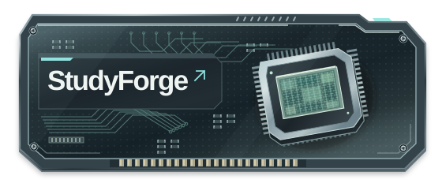
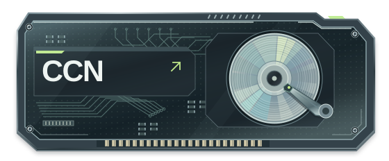

  <picture>
    <source media="(max-width: 600px) and (prefers-reduced-motion: reduce)" srcset="./assets/console-mobile-still.svg" />
    <source media="(prefers-reduced-motion: reduce)" srcset="./assets/console-still.svg" />
    <source media="(max-width: 600px)" srcset="./assets/console-mobile.svg" />
    
  </picture>

我是 Dong，做测试开发，关注 Windows 安全和 AI 应用。掌机里跑的是我过去一年的公开贡献日历，每个亮格代表一个有贡献的日子。

贡献快照 · <!-- snake-updated -->2026-11-26 16:32<!-- /snake-updated -->（北京时间） · <a href="https://github.com/CWDONG404/CWDONG404/actions/workflows/contribution-animation.yml">生成记录</a>

## 项目卡带

  
  

**[知题 StudyForge](https://github.com/CWDONG404/Self-Topic-Generation)** 把备考资料变成题库。出题和审题分开，遇到有疑问的解析，可以直接翻回 PDF 原文核对。

**[CCN 技术赛事情报台](https://github.com/CWDONG404/Computer-Competition-Network)** 把比赛、黑客松和证书收进同一份日历，每条记录都保留主办方来源和核验日期。

[个人博客](https://github.com/CWDONG404/blog) · 测试开发与工程笔记　／　[Todolist](https://github.com/CWDONG404/todolist) · 本地任务清单

<strong>常用工具与最近的实验</strong>

- 测试与服务端 · `Python` `Playwright` `FastAPI` `PostgreSQL` `MongoDB`
- 前端与部署 · `TypeScript` `React` `Vue` `Vite` `Docker`
- 本地模型 · 用 `Ollama` 跑模型，练习 RAG 检索和 LoRA 微调，用 `LangGraph` 拆分出题与审题流程。

[查看全部公开仓库 ↗](https://github.com/CWDONG404?tab=repositories&type=public)
